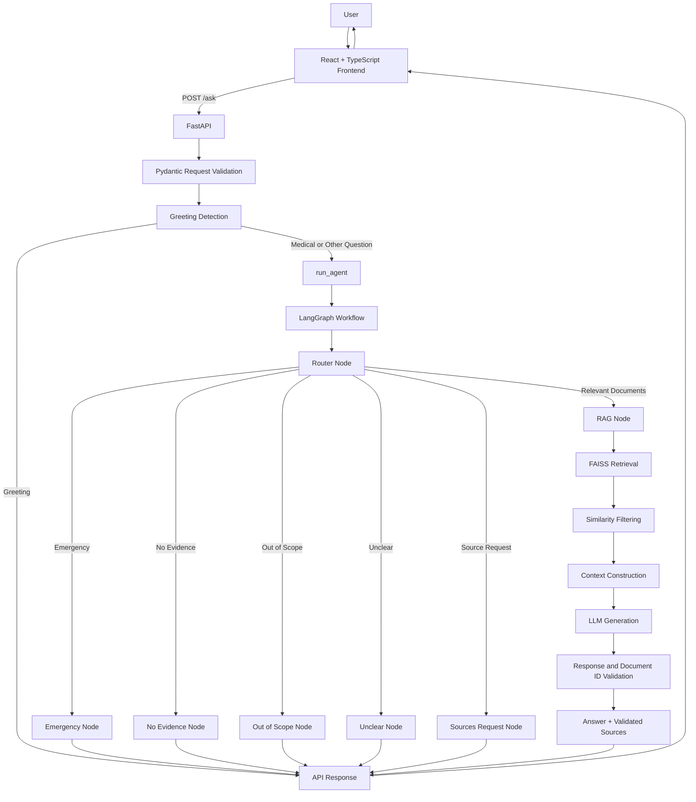
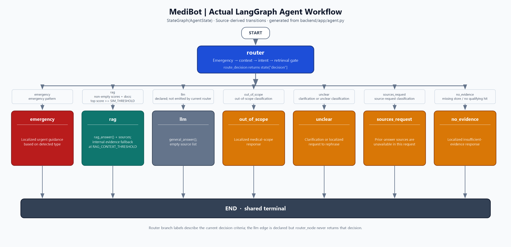

# MediBot — Intelligent Medical Chatbot with RAG

**Project type:** Personal project — AI & Full-Stack Development  
**Status:** Functional prototype — Under testing and improvement

MediBot is an AI-powered medical information chatbot designed to answer general health-related questions using a medical knowledge base.

The application combines **Retrieval-Augmented Generation (RAG)**, semantic search with FAISS, Large Language Models (LLMs), and a LangGraph-based conversational workflow.

Its objective is to provide contextualized answers grounded in available medical documents, with source references when valid references are available.

> **Medical disclaimer:** MediBot is an informational tool, not a medical diagnostic system. It does not replace professional medical advice, diagnosis, or treatment.

---

## 1. Key Features

- Conversational interface built with React and TypeScript.
- Multilingual question processing in French, English, and Arabic.
- Semantic retrieval from a structured medical knowledge base.
- Vector similarity search using FAISS and Sentence Transformers.
- Context-aware response generation using LLMs.
- Configurable LLM providers: Google Gemini and Ollama.
- Source attribution based on validated document references.
- Conversational history support for follow-up questions.
- LangGraph-based routing and workflow orchestration.
- Detection of selected medical emergency patterns.
- Handling of out-of-scope and unclear questions.
- Fallback responses when relevant medical evidence is unavailable.

## 2. Technology Stack

| Component | Technology |
|---|---|
| Frontend | React 19, TypeScript |
| Build tool | Vite |
| Styling | Tailwind CSS 4 |
| Animations | Framer Motion |
| Icons | Lucide React |
| Backend | Python |
| API framework | FastAPI |
| Data validation | Pydantic |
| Workflow orchestration | LangGraph |
| Vector search | FAISS |
| Embeddings | Sentence Transformers |
| Embedding model | `paraphrase-multilingual-MiniLM-L12-v2` |
| Primary LLM provider | Google Gemini |
| Alternative LLM provider | Ollama |
| Knowledge base | JSON |

## 3. System Architecture

MediBot follows a frontend/backend architecture.

- **Frontend:** React application responsible for the chat interface, user input, conversation history, and response presentation.
- **Backend:** FastAPI application responsible for request validation, medical data loading, vector search, conversational processing, and LLM integration.
- **AI workflow:** LangGraph coordinates the processing of incoming questions.
- **Retrieval pipeline:** FAISS retrieves relevant medical documents, which are filtered and passed to the LLM as contextual information.

### 3.1 High-Level Architecture



The graph also contains an `llm` node for general LLM responses. Its actual routing should be completed or verified: the examined `router_node` does not explicitly return an `llm` decision.

### 3.2 LangGraph Workflow

The workflow is orchestrated through LangGraph and uses a shared state to manage information required during question processing.

The main nodes are:

| Node | Responsibility |
|---|---|
| `router` | Analyzes the incoming question and determines the processing path |
| `rag` | Executes the document-based RAG pipeline |
| `llm` | Generates a general response through `general_answer()` |
| `emergency` | Handles selected emergency-related patterns |
| `no_evidence` | Handles questions without sufficient documentary evidence |
| `out_of_scope` | Handles questions outside the medical domain |
| `unclear` | Handles ambiguous or insufficiently understood questions |
| `sources_request` | Handles requests for references to a previous answer |

The router prioritizes emergency detection, processes follow-up context, evaluates the question's intent, and considers retrieval relevance when determining the next step.

**Implementation note:** The `llm` node exists in the graph, but its routing path must be checked against the current router logic before considering it an active route.

## LangGraph Agent Architecture

The following diagram illustrates the actual MediBot LangGraph nodes and conditional transitions declared in the backend.

See the [architecture documentation](backend/docs/langgraph-architecture.md) for node responsibilities, routing conditions, and implementation details.


## 4. Backend API

The backend exposes two endpoints using the same `/ask` path with different HTTP methods.


## LangGraph Agent Architecture

The following diagram illustrates the actual MediBot LangGraph nodes and conditional transitions declared in the backend.

See the [architecture documentation](backend/docs/langgraph-architecture.md) for node responsibilities, routing conditions, and implementation details.


### 4.1 GET `/ask`

Legacy endpoint for submitting a question without conversation history.

Example:

```http
GET /ask?question=What are the symptoms of flu?
```

The endpoint processes the question through `_process_question()` and returns the answer and available sources.

### 4.2 POST `/ask`

Main endpoint supporting conversational history.

Example request:

```json
{
  "question": "What about its symptoms?",
  "history": [
    {
      "sender": "user",
      "message": "What is appendicitis?"
    },
    {
      "sender": "bot",
      "message": "Appendicitis is inflammation of the appendix."
    }
  ]
}
```

Example response:

```json
{
  "answer": "Common symptoms include abdominal pain...",
  "sources": [
    {
      "name": "NHS",
      "url": "https://www.nhs.uk/conditions/appendicitis/"
    }
  ]
}
```

The response example illustrates the API structure; the actual answer and source objects depend on the backend result.

### 4.3 Request Validation

Pydantic models validate incoming data.

- `AskRequest.question`: required string, between 1 and 2,000 characters.
- `AskRequest.history`: list of conversation turns, maximum 12 entries.
- `ChatTurn.sender`: identifies the message sender.
- `ChatTurn.message`: string limited to 2,000 characters.

Only messages whose sender is `user` or `bot` are retained when preparing the history for the agent.

The backend also:
- Removes leading and trailing whitespace from the question.
- Returns a localized input message when the question is empty.
- Detects greetings before invoking the agent.
- Returns a consistent response structure containing `answer` and `sources`.

## 5. Medical Knowledge Base and Vector Search

### 5.1 Medical Dataset

The knowledge base is stored in:

```text
backend/data/data_enriched_v3.json
```

It contains structured medical information, including:

- Medical questions.
- Answers.
- Keywords.
- Related questions.
- Medical categories.
- Source names and URLs when available.

The dataset is loaded when the backend starts.

### 5.2 Embedding Generation

The embedding model is:

```text
paraphrase-multilingual-MiniLM-L12-v2
```

It converts the medical documents and user queries into numerical vector representations.

For each document, the text used to generate embeddings combines:

- `question`
- `answer`
- `keywords`
- `related_questions`
- `category`

The encoding operation is performed through the project's `encode()` function.

### 5.3 FAISS Index

The vector store is implemented in `FAISSStore`.

It uses:

```python
faiss.IndexFlatIP(embedding_dimension)
```

The index uses inner product similarity. With normalized embeddings, this corresponds to cosine similarity.

The index is initialized with the embeddings of all loaded medical documents.

### 5.4 Retrieval and Query Expansion

The `search()` method searches the original user query and can generate additional focused queries for selected medical topics.

The currently configured topic expansions are:

| Topic | Example aliases |
|---|---|
| Dehydration | `dehydration`, `dehydrated`, Arabic equivalents |
| Diabetes | `diabetes`, `blood sugar`, Arabic equivalents |
| Dizziness | `dizziness`, `dizzy`, `lightheadedness`, Arabic equivalents |

For each query:

1. The query is encoded into an embedding.
2. FAISS retrieves the most similar documents.
3. Results are collected and merged.
4. Documents are identified using their IDs when available.
5. When the same document is retrieved multiple times, its highest similarity score is retained.
6. Results are sorted by descending similarity score.

This approach allows the retrieval process to combine the original question with selected topic-specific queries.

**Current limitation:** Query expansion is explicitly implemented for the listed topics; it is not a general query-expansion mechanism for every medical condition.

### 5.5 Retrieval Parameters

The default configuration includes:

| Parameter | Default value | Description |
|---|---:|---|
| `TOP_K` | `2` | Number of documents requested by the RAG pipeline |
| `SIM_THRESHOLD` | `0.35` | Similarity threshold used by the routing logic |
| `RAG_CONTEXT_THRESHOLD` | `0.35` | Minimum score for including a document in the RAG context |

The `FAISSStore.search()` method has its own default `k=3`. However, the RAG pipeline normally passes `TOP_K` explicitly, whose configured default is `2`.

These values are configurable and should be evaluated against a representative medical question test set.

## 6. Retrieval-Augmented Generation (RAG)

The RAG implementation is located in:

```text
backend/app/rag/rag_pipeline.py
```

The main function is:

```python
async def rag_answer(query, store, retrieval=None):
```

### 6.1 RAG Processing Steps

1. Detect the language of the user's question.
2. Retrieve documents through FAISS, or reuse retrieval results already supplied by the agent.
3. Filter documents using `RAG_CONTEXT_THRESHOLD`.
4. Return a localized fallback response if no relevant documents remain.
5. Construct a context containing the selected documents' medical information.
6. Build a prompt with instructions to rely exclusively on the supplied documentary answers.
7. Request a structured JSON response from the LLM.
8. Parse and validate the generated JSON.
9. Validate the document IDs returned by the model.
10. Return the answer and corresponding validated sources.

### 6.2 Context Construction

The context includes available document information such as:

- Document question.
- Medical answer.
- Keywords.
- Related questions.
- Source name and URL when valid.

The prompt explicitly instructs the model to:
- Use only medical facts supported by the supplied document answers.
- Avoid inventing facts or references.
- Avoid presenting symptoms as confirmation of a diagnosis.
- Select only document IDs that directly support the answer.
- Treat keywords and related questions as retrieval aids, not as medical evidence.
- Provide clear safety advice for emergency symptoms.

### 6.3 Structured LLM Output

The RAG prompt requests the following JSON format:

```json
{
  "answer": "Generated medical information...",
  "used_document_ids": [1, 2]
}
```

The backend validates the returned structure.

It checks that:
- The response is a valid JSON object.
- `answer` is a non-empty string.
- `used_document_ids` is a list.
- Document IDs are integers within the range of the selected context.
- Duplicate IDs are removed.

Invalid IDs are ignored rather than used to generate source references.

### 6.4 Source Validation

Sources are extracted from the selected documents only when their metadata is valid.

The validation process checks:
- Source name is a non-empty string.
- Source URL is a non-empty string.
- URL uses HTTP or HTTPS.
- URL contains no username or password.
- Generic or unverified source names are rejected.
- Duplicate URLs are removed.

The backend therefore returns references corresponding to documents selected by the model and accepted by the validation logic.

**Important:** This validation improves source traceability, but it does not independently verify that every generated medical statement is scientifically correct.

## 7. LLM Integration

LLM provider selection is centralized in:

```text
backend/app/llm/llm_service.py
```

The `generate()` function dispatches requests to the configured provider.

```python
async def generate(prompt: str) -> str:
    if LLM_PROVIDER == "gemini":
        return await gemini_generate(prompt)

    if LLM_PROVIDER == "ollama":
        return await ollama_generate(prompt)

    raise ValueError(...)
```

### Supported providers

| Provider | Role |
|---|---|
| Google Gemini | Default configured provider |
| Ollama | Alternative local model provider |

The default configuration in `config.py` is:

```env
LLM_PROVIDER=gemini
GEMINI_MODEL_NAME=gemini-flash-lite-latest
MODEL_NAME=phi3
OLLAMA_URL=http://localhost:11434/api/generate
```

The Gemini model name and Ollama model name can be changed through environment variables.

The RAG pipeline uses the shared `generate()` function, allowing the provider to be changed through configuration without changing the RAG logic.

The project also includes a `general_answer()` function for general medical information. It applies additional instructions to avoid definitive diagnosis, unsupported references, and personalized medication or dosage recommendations without sufficient context.

## 8. Emergency Detection and Safety Handling

Emergency detection is integrated into the LangGraph routing process.

The current implementation uses text patterns and regular expressions to identify selected emergency-related situations.

Examples of supported categories include:

- Cardiac symptoms.
- Breathing difficulties.
- Breathing arrest.
- Stroke warning signs.
- Unconsciousness.
- Other potentially serious situations.

The router checks the original user message for emergency patterns before follow-up resolution and normal intent classification.

When a recognized emergency pattern is detected, the workflow routes the request to the `emergency` node.

The response may include urgent safety instructions and an associated reference when available.

**Limitations:** Pattern-based detection cannot recognize every possible emergency description and may be affected by negations, spelling variations, context, or ambiguous wording. It must not be treated as a substitute for professional emergency assessment.

## 9. Conversation History and Follow-up Questions

The POST endpoint supports conversation history.

The history is converted into dictionaries and passed to `run_agent()`.

This allows the workflow to resolve certain follow-up questions using previous user messages.

The current follow-up resolution mechanism relies on configured medical topics and aliases. It attempts to identify the most recent relevant medical subject when the current question depends on previous context.

For example:

```text
User: What is appendicitis?
Bot: Appendicitis is inflammation of the appendix.
User: What are its symptoms?
```

The system can use the previous medical topic to interpret the follow-up question.

**Current limitation:** Follow-up resolution depends on the topics and aliases implemented in the code. It is not unrestricted conversational memory or a general-purpose semantic history retrieval system.

## 10. Frontend

The frontend is implemented with React, TypeScript, and Vite.

### Main technologies

- React 19.
- TypeScript.
- Vite.
- Tailwind CSS 4.
- Framer Motion.
- Lucide React.

### Main interface capabilities

- Chat-oriented user interface.
- Message rendering for user and assistant.
- Question input and submission.
- Conversation history management.
- Loading and typing indicators.
- Suggested questions.
- Light and dark theme support.
- Animated interface elements.

The frontend communicates with the FastAPI backend through the `/ask` endpoint and displays the returned answer and available references.

## 11. Project Structure

```text
MediBot/
│
├── backend/
│   ├── app/
│   │   ├── api/
│   │   │   └── routes.py
│   │   │
│   │   ├── core/
│   │   │   ├── config.py
│   │   │   └── language_utils.py
│   │   │
│   │   ├── data/
│   │   │   ├── loader.py
│   │   │   └── embedding.py
│   │   │
│   │   ├── llm/
│   │   │   ├── llm_service.py
│   │   │   ├── gemini_client.py
│   │   │   └── ollama_client.py
│   │   │
│   │   ├── rag/
│   │   │   └── rag_pipeline.py
│   │   │
│   │   ├── vectorstore/
│   │   │   └── faiss_store.py
│   │   │
│   │   ├── agent.py
│   │   └── main.py
│   │
│   ├── data/
│   │   └── data_enriched_v3.json
│   │
│   ├── tests/
│   └── ...
│
├── frontend/
│   ├── src/
│   │   ├── components/
│   │   ├── services/
│   │   ├── types/
│   │   └── App.tsx
│   │
│   ├── package.json
│   └── ...
│
└── README.md
```

This is a functional overview of the project structure. Additional configuration, styling, and utility files may exist in the repository.

## 12. Installation and Setup

### 12.1 Prerequisites

- Python.
- Node.js and npm.
- A Google Gemini API key or a configured Ollama installation.
- Backend and frontend dependencies.

### 12.2 Backend Setup

Navigate to the backend directory:

```bash
cd backend
```

Create and activate a virtual environment.

**Windows:**

```powershell
python -m venv .venv
.venv\Scripts\activate
```

**Linux / macOS:**

```bash
python -m venv .venv
source .venv/bin/activate
```

Install the backend dependencies using the project's dependency file, if available:

```bash
pip install -r requirements.txt
```

Create a `.env` file inside the backend directory:

```env
LLM_PROVIDER=gemini

GEMINI_API_KEY=your_gemini_api_key
GEMINI_MODEL_NAME=gemini-flash-lite-latest

MODEL_NAME=phi3
OLLAMA_URL=http://localhost:11434/api/generate

TOP_K=2
SIM_THRESHOLD=0.35
RAG_CONTEXT_THRESHOLD=0.35
```

To use Ollama instead:

```env
LLM_PROVIDER=ollama
MODEL_NAME=phi3
OLLAMA_URL=http://localhost:11434/api/generate
```

Never commit API keys or the `.env` file to the repository.

### 12.3 Start the Backend

From the backend directory:

```bash
uvicorn app.main:app --reload
```

The API should be available at:

```text
http://127.0.0.1:8000
```

FastAPI interactive documentation:

```text
http://127.0.0.1:8000/docs
```

### 12.4 Frontend Setup

Navigate to the frontend directory:

```bash
cd frontend
```

Install dependencies:

```bash
npm install
```

Start the Vite development server:

```bash
npm run dev
```

Vite displays the local frontend URL in the terminal.

### 12.5 Frontend Build and Quality Checks

The frontend defines the following scripts:

```bash
npm run dev
npm run build
npm run lint
npm run preview
```

- `dev`: starts the development server.
- `build`: runs TypeScript project checks and builds the production frontend.
- `lint`: runs ESLint.
- `preview`: previews the production build locally.

## 13. Testing and Validation

Testing has focused on document retrieval, medical question routing, emergency handling, and response generation.

The following table summarizes observed test scenarios. These results are not a claim of exhaustive validation.

| Test scenario | Observed result | Status |
|---|---|---|
| Appendicitis symptoms | Document ID 37 retrieved, similarity score 0.8396, NHS source returned | Passed in observed test |
| Appendicitis causes | Routed to `unclear` instead of the expected medical retrieval path | Needs improvement |
| Antibiotics for common cold | Document ID 18 retrieved, CDC source returned | Passed in observed test |
| Stroke warning signs | Document ID 20 retrieved, NHS source returned | Passed in observed test |
| Severe chest pain | Response advised contacting emergency services and not driving | Appropriate response observed |
| Capital of Tunisia | Classified as outside the medical domain | Passed in observed test |

### Areas Requiring Further Testing

- Medical intent classification for different question types.
- Follow-up resolution across longer conversations.
- Emergency detection with negations and multilingual wording.
- Retrieval quality for questions about causes, symptoms, prevention, and treatment.
- Relevance thresholds and document ranking.
- JSON parsing and validation of LLM responses.
- Source attribution consistency.
- API error handling and frontend/backend communication.
- Response latency and resource consumption.

## 14. Current Limitations

MediBot is a prototype under active development.

Known limitations include:

- The medical knowledge base does not cover every medical question.
- Query expansion is currently limited to selected topics.
- Similarity thresholds require further evaluation.
- Follow-up resolution relies on configured medical topics and aliases.
- Emergency detection uses text patterns and regular expressions.
- LLM responses may contain errors even with grounding instructions.
- Source validation does not independently verify every medical claim.
- The general `llm` graph route requires further verification.

MediBot is not a certified medical device and should not be used as a diagnostic or treatment decision system.

## 15. Future Improvements

Planned development priorities include:

1. Improve medical intent classification, particularly for questions about causes and prevention.
2. Expand the medical knowledge base with reliable references.
3. Improve query expansion and retrieval ranking.
4. Evaluate and tune FAISS similarity thresholds.
5. Improve multilingual emergency detection and negation handling.
6. Strengthen follow-up question resolution.
7. Verify and complete LangGraph routing, including the general LLM route.
8. Expand automated tests for retrieval, routing, source validation, and safety.
9. Improve error handling and frontend/backend integration.
10. Evaluate response quality, latency, and system performance.

## 16. Conclusion

MediBot is a practical application of **Retrieval-Augmented Generation, semantic search, LLM integration, and conversational workflow orchestration** in the medical information domain.

By combining React, TypeScript, FastAPI, LangGraph, FAISS, Sentence Transformers, and configurable LLM providers, the project demonstrates the development of an AI-powered full-stack application with document-grounded response generation.

It also provides hands-on experience in AI engineering, RAG pipelines, vector databases, prompt design, API development, and responsible handling of medical information.

---

## Repository

GitHub: https://github.com/essiaajroud/medical-rag-chatbot.git

