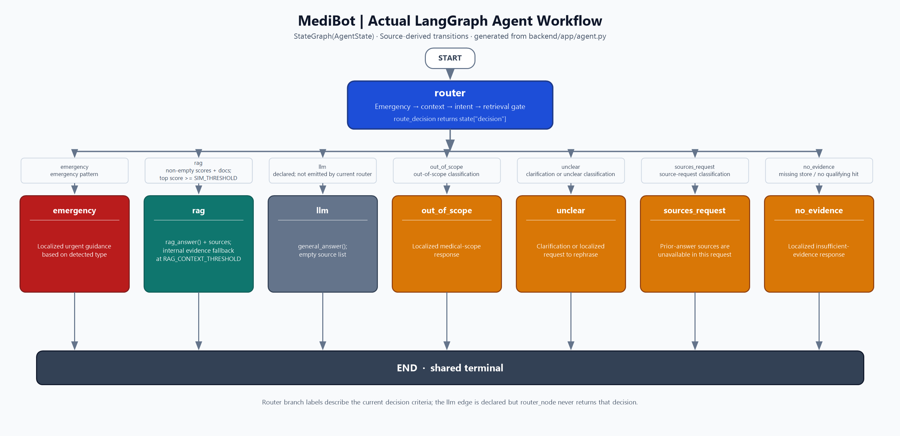

# MediBot LangGraph Agent Architecture

The workflow is constructed in [`app/agent.py`](../app/agent.py) with
`StateGraph(AgentState)` and compiled as `graph = builder.compile()`.
`run_agent` invokes it with `graph.ainvoke`. The graph starts at `router`,
which returns a `decision` used by `route_decision` to select one of seven
declared branches. Each selected node is terminal: it returns a response and
ends at LangGraph's `END` node.

`AgentState` is a `TypedDict` with these fields: `question: str`,
`store: object`, `decision: str`, `emergency_type: str`, `response: object`,
`retrieval: object`, `history: list[dict]`, and `clarification: str`.

The [PNG](screenshots/08-langgraph-architecture.png) and
[Mermaid source](screenshots/langgraph-architecture.mmd) are in
[`docs/screenshots`](screenshots/).

## Nodes

| Node | Responsibility |
|---|---|
| `router` | Checks the original question for emergency patterns first; resolves context-dependent follow-ups; classifies the resulting question; and, for other intents, searches the store and records retrieval results or `no_evidence`. |
| `rag` | Calls `rag_answer` with the question, store, and any retrieval results provided by the router. |
| `llm` | Calls `general_answer` and returns the answer with an empty source list. This node is declared but the current `router_node` does not assign the `llm` decision. |
| `emergency` | Returns a localized emergency response based on `emergency_type`, with selected emergency sources where configured. |
| `out_of_scope` | Returns a localized response that MediBot handles health-related questions. |
| `unclear` | Returns a follow-up clarification when one was prepared by the router, or a localized prompt to clarify the question. |
| `sources_request` | Returns a localized explanation that sources from a previous answer are unavailable in the current request. |
| `no_evidence` | Returns a localized message that the medical knowledge base did not provide enough information. |

## Routing and terminal paths

`route_decision(state)` returns `state["decision"]`. The conditional edge from
`router` maps these exact values to nodes: `rag`, `llm`, `emergency`,
`out_of_scope`, `unclear`, `sources_request`, and `no_evidence`. The graph
declaration allows the `llm` branch, but the current router implementation
never sets `decision` to `llm`; no current router path to that branch can be
confirmed.

The router chooses a decision in this order:

1. It checks the original user question with `detect_emergency_type`; a match
   sets `emergency`.
2. It attempts to resolve a context-dependent follow-up from recent user
   history. If the topic is missing or ambiguous, it sets `unclear` and
   includes a clarification.
3. It classifies the (possibly resolved) question. Emergency, source request,
   out-of-scope, and unclear classifications route to their corresponding
   nodes.
4. For other classifications, if no store is available, it sets
   `no_evidence`. Otherwise it searches the store with `TOP_K`. A non-empty
   result whose first score is at least `SIM_THRESHOLD` sets `rag` and stores
   the results; empty results or a lower top score set `no_evidence`.

The `no_evidence` node has an explicit edge to `END`. The graph also sets
`rag`, `llm`, `emergency`, `out_of_scope`, `unclear`, and `sources_request` as
finish points, so these branches also terminate at `END`.

There is a second, distinct evidence fallback inside `rag_answer`: it filters
router-provided search results using `RAG_CONTEXT_THRESHOLD`. If no document
passes that filter, `rag` itself returns a localized insufficient-evidence
response and empty sources. The implementation does not route from `rag` to
the `no_evidence` node.

## Scope and implementation notes

Emergency handling only covers patterns present in `detect_emergency_type`;
the source does not establish detection of every possible emergency. Source
requests are answered as requests for prior-answer sources, but the node says
those sources are unavailable in this request. The `llm` node is present in
the graph declaration but is not selected by the current router code.

The current environment does not have LangGraph or Mermaid CLI installed, so
the compiled graph's `draw_mermaid()` / `draw_mermaid_png()` methods and a
Mermaid renderer could not be invoked. The Mermaid file was transcribed from
the `StateGraph` declarations and router implementation; the PNG is a
high-resolution local rendering of the same transitions. To render the
Mermaid source with Mermaid CLI, run
`npx @mermaid-js/mermaid-cli -i backend/docs/screenshots/langgraph-architecture.mmd -o backend/docs/screenshots/08-langgraph-architecture.png`.
No runtime graph behavior was changed.
